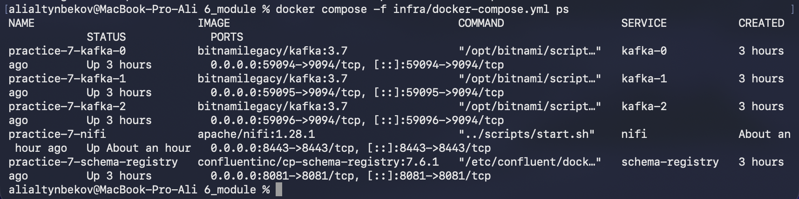
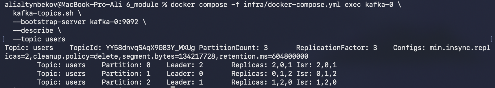
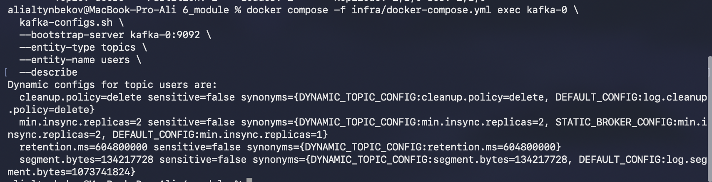
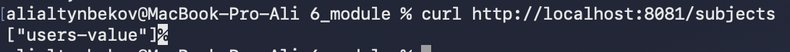
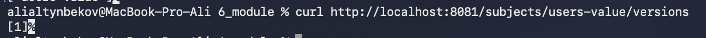
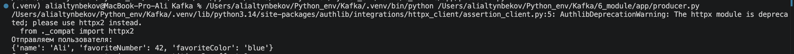
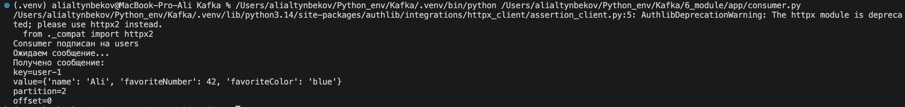
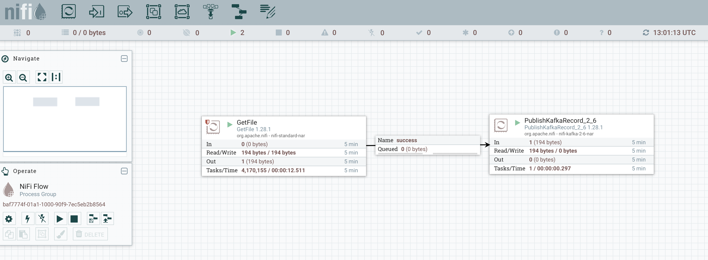
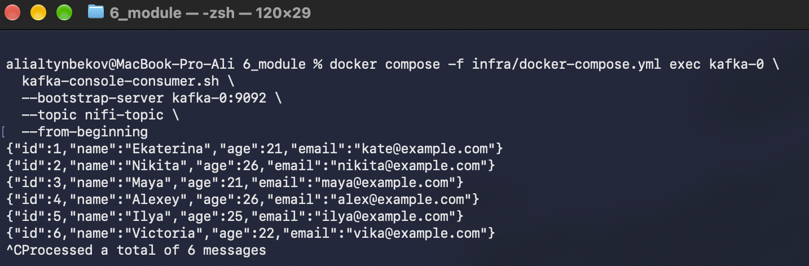

# Практическая работа №7  
## Apache Kafka, Schema Registry и Apache NiFi

## 1. Описание работы

Цель практической работы — развернуть кластер Apache Kafka из трёх брокеров, настроить параметры хранения данных, подключить Schema Registry, реализовать producer и consumer, а также настроить интеграцию Kafka с Apache NiFi

Изначально по заданию предполагалось использовать Yandex Cloud. При выполнении работы возникли технические сложности с облачной платформой: длительное выделение необходимых квот и начало тарификации виртуальной машины до возможности полноценно развернуть требуемый Kafka-кластер

У меня никакого гранта не наблюдается. Видел в сообщениях, что до создания кластера человек не дошёл, но с него уже начали списывать деньги за виртуальную машину
И Yandex облако для работы вряд-ли понадобится в обозримом будущем

В связи с ограниченным временем практическая работа выполнена локально с использованием Docker Desktop

При этом все основные технические требования задания реализованы:

| Требование | Реализация |
|---|---|
| Kafka-кластер | 3 брокера |
| Режим Kafka | KRaft, без ZooKeeper |
| Партиции topic | 3 |
| Replication Factor | 3 |
| Настройки хранения | `cleanup.policy`, `retention.ms`, `segment.bytes` |
| Schema Registry | Confluent Schema Registry |
| Формат схемы | JSON Schema |
| Producer | Python / confluent-kafka |
| Consumer | Python / confluent-kafka |
| Интеграция | Apache NiFi |
| NiFi → Kafka | CSV → JSON → `nifi-topic` |

---

## 2. Архитектура

```text
                         Docker Desktop

┌───────────────────────────────────────────────────────┐
│                                                       │
│                  Apache Kafka KRaft                   │
│                                                       │
│     kafka-0          kafka-1          kafka-2         │
│     broker +         broker +         broker +        │
│     controller       controller       controller      │
│        │                 │                 │           │
│        └──── Replication Factor = 3 ──────┘           │
│                                                       │
│            ┌─────────────────────────┐                │
│            │                         │                │
│            ▼                         ▼                │
│     Schema Registry              Apache NiFi         │
│        :8081                      :8443               │
│            │                         │                │
│            │                         ▼                │
│            │                    nifi-topic            │
│            │                                          │
│            ▼                                          │
│       users topic                                     │
│            │                                          │
│     Python Producer                                   │
│     Python Consumer                                   │
│                                                       │
└───────────────────────────────────────────────────────┘
```

---

## 3. Используемое окружение

Работа выполнена локально на macOS с использованием Docker Desktop

Kafka brokers работают как отдельные Docker-контейнеры и используют отдельные Docker volumes:

```text
kafka-0 → kafka_0_data
kafka-1 → kafka_1_data
kafka-2 → kafka_2_data
```

В `docker-compose.yml` отдельные ограничения CPU/RAM для брокеров не задавались, поэтому контейнеры используют общие ресурсы Docker Desktop

Для production-среды аппаратные ресурсы должны подбираться исходя из реальной нагрузки, количества partition, объёма данных, retention, throughput и требований к отказоустойчивости

---

## 4. Структура проекта

```text
6_module/
├── app/
│   ├── producer.py
│   ├── consumer.py
│   └── nifi_consumer.py
│
├── infra/
│   └── docker-compose.yml
│
├── nifi/
│   ├── data/
│   │   └── input.csv
│   └── inbox/
│
├── schema/
│   └── user.json
│
├── screenshots/
│   ├── 01-kafka-containers.png
│   ├── 02-users-topic-describe.png
│   ├── 03-users-topic-config.png
│   ├── 04-schema-subjects.png
│   ├── 05-schema-versions.png
│   ├── 06-producer-success.png
│   ├── 07-consumer-success.png
│   ├── 08-nifi-flow.png
│   └── 09-nifi-kafka-messages.png
│
├── scripts/
├── requirements.txt
└── README.md
```

---

## 5. Kafka-кластер

Используется Apache Kafka `3.7` в режиме KRaft.

Количество узлов:

```text
3 brokers
3 controllers
```

Каждый Kafka container одновременно выполняет две роли:

```text
broker,controller
```

Controller quorum:

```text
0@kafka-0:9093
1@kafka-1:9093
2@kafka-2:9093
```

Внешние порты:

| Broker | Внутренний listener | Внешний порт |
|---|---|---:|
| kafka-0 | `kafka-0:9092` | `localhost:59094` |
| kafka-1 | `kafka-1:9092` | `localhost:59095` |
| kafka-2 | `kafka-2:9092` | `localhost:59096` |

Запуск инфраструктуры:

```bash
docker compose -f infra/docker-compose.yml up -d
```

Проверка:

```bash
docker compose -f infra/docker-compose.yml ps
```



---

## 6. Topic `users`

Основной topic:

```text
users
```

Параметры:

| Параметр | Значение |
|---|---:|
| Partitions | 3 |
| Replication Factor | 3 |
| `min.insync.replicas` | 2 |
| `cleanup.policy` | `delete` |
| `retention.ms` | `604800000` |
| `segment.bytes` | `134217728` |

`retention.ms=604800000` соответствует хранению сообщений в течение 7 суток

`segment.bytes=134217728` соответствует размеру Kafka log segment 128 MiB

Topic создаётся командой:

```bash
docker compose -f infra/docker-compose.yml exec kafka-0 \
  kafka-topics.sh \
  --bootstrap-server kafka-0:9092 \
  --create \
  --topic users \
  --partitions 3 \
  --replication-factor 3 \
  --config cleanup.policy=delete \
  --config retention.ms=604800000 \
  --config segment.bytes=134217728 \
  --config min.insync.replicas=2
```

Проверка topic:

```bash
docker compose -f infra/docker-compose.yml exec kafka-0 \
  kafka-topics.sh \
  --bootstrap-server kafka-0:9092 \
  --describe \
  --topic users
```

Результат:

```text
PartitionCount: 3
ReplicationFactor: 3
```

Для каждой partition присутствуют три replica и три ISR.



Проверка конфигурации:

```bash
docker compose -f infra/docker-compose.yml exec kafka-0 \
  kafka-configs.sh \
  --bootstrap-server kafka-0:9092 \
  --entity-type topics \
  --entity-name users \
  --describe
```

Настроены:

```text
cleanup.policy=delete
min.insync.replicas=2
retention.ms=604800000
segment.bytes=134217728
```



---

## 7. Schema Registry

Schema Registry запущен отдельным Docker container:

```text
confluentinc/cp-schema-registry:7.6.1
```

REST API доступен по адресу:

```text
http://localhost:8081
```

Schema Registry подключается к Kafka через внутренние Docker listeners:

```text
kafka-0:9092
kafka-1:9092
kafka-2:9092
```

Для хранения schemas Schema Registry автоматически использует внутренний Kafka topic:

```text
_schemas
```

---

## 8. JSON Schema

Используется JSON Schema:

```text
schema/user.json
```

Содержимое:

```json
{
  "$schema": "http://json-schema.org/draft-07/schema#",
  "title": "User",
  "type": "object",
  "properties": {
    "name": {
      "type": "string"
    },
    "favoriteNumber": {
      "type": "integer"
    },
    "favoriteColor": {
      "type": "string"
    }
  },
  "required": [
    "name",
    "favoriteNumber",
    "favoriteColor"
  ]
}
```

Schema зарегистрирована под subject:

```text
users-value
```

Проверка subjects:

```bash
curl http://localhost:8081/subjects
```

Результат:

```json
["users-value"]
```



Проверка зарегистрированных версий:

```bash
curl http://localhost:8081/subjects/users-value/versions
```

Результат:

```json
[1]
```



Получение информации о первой версии:

```bash
curl http://localhost:8081/subjects/users-value/versions/1
```

Schema Registry возвращает:

```text
subject = users-value
version = 1
id = 1
schemaType = JSON
```

---

## 9. Python Producer

Producer реализован в:

```text
app/producer.py
```

Используются:

```text
confluent-kafka
SchemaRegistryClient
JSONSerializer
```

Kafka brokers:

```text
localhost:59094
localhost:59095
localhost:59096
```

Schema Registry:

```text
http://localhost:8081
```

Producer отправляет объект:

```python
{
    "name": "Ali",
    "favoriteNumber": 42,
    "favoriteColor": "blue"
}
```

в topic:

```text
users
```

Запуск:

```bash
python app/producer.py
```

Пример успешного результата:

```text
Отправляем пользователя:
{'name': 'Ali', 'favoriteNumber': 42, 'favoriteColor': 'blue'}

Сообщение доставлено:
topic=users
partition=2
offset=0
```



---

## 10. Python Consumer

Consumer реализован в:

```text
app/consumer.py
```

Для десериализации сообщений используется:

```text
SchemaRegistryClient
JSONDeserializer
```

Запуск:

```bash
python app/consumer.py
```

Пример результата:

```text
Consumer подписан на users
Ожидаем сообщение...

Получено сообщение:
key=user-1
value={'name': 'Ali', 'favoriteNumber': 42, 'favoriteColor': 'blue'}
partition=2
offset=0
```



---

## 11. Интеграция Apache NiFi с Kafka

Для второй части задания используется Apache NiFi `1.28.1`.

Web UI:

```text
https://localhost:8443/nifi
```

Для передачи данных используется следующий flow:

```text
input.csv
    ↓
GetFile
    ↓
CSVReader
    ↓
PublishKafkaRecord_2_6
    ↓
JsonRecordSetWriter
    ↓
Kafka
    ↓
nifi-topic
```

NiFi подключается к Kafka по внутренним Docker addresses:

```text
kafka-0:9092
kafka-1:9092
kafka-2:9092
```

---

## 12. NiFi GetFile

Processor:

```text
GetFile
```

Основные параметры:

| Параметр | Значение |
|---|---|
| Input Directory | `/opt/nifi/nifi-current/data` |
| File Filter | `.*\.csv` |
| Keep Source File | `false` |
| Polling Interval | `5 sec` |

Исходный CSV:

```text
nifi/data/input.csv
```

Рабочая копия помещается в:

```text
nifi/inbox/input.csv
```

Команда:

```bash
cp nifi/data/input.csv nifi/inbox/input.csv
```

---

## 13. CSVReader

Controller Service:

```text
CSVReader
```

Настройки:

```text
Schema Access Strategy = Infer Schema
Treat First Line as Header = true
```

Первая строка CSV:

```csv
id,name,age,email
```

используется как названия полей.

---

## 14. JsonRecordSetWriter

Controller Service:

```text
JsonRecordSetWriter
```

Настройки:

```text
Schema Write Strategy = Do Not Write Schema
Schema Access Strategy = Inherit Record Schema
Output Grouping = One Line Per Object
Pretty Print JSON = false
```

---

## 15. PublishKafkaRecord_2_6

Processor:

```text
PublishKafkaRecord_2_6
```

Основные параметры:

```text
Kafka Brokers:
kafka-0:9092,kafka-1:9092,kafka-2:9092

Topic Name:
nifi-topic

Security Protocol:
PLAINTEXT

Record Reader:
CSVReader

Record Writer:
JsonRecordSetWriter

Use Transactions:
false
```

Flow:

```text
GetFile
   │
   │ success
   ▼
PublishKafkaRecord_2_6
```



---

## 16. Topic `nifi-topic`

Для NiFi создан отдельный Kafka topic:

```text
nifi-topic
```

Параметры:

```text
partitions = 3
replication.factor = 3
```

Создание:

```bash
docker compose -f infra/docker-compose.yml exec kafka-0 \
  kafka-topics.sh \
  --bootstrap-server kafka-0:9092 \
  --create \
  --topic nifi-topic \
  --partitions 3 \
  --replication-factor 3
```

---

## 17. Проверка передачи NiFi → Kafka

Для проверки используется Kafka Console Consumer:

```bash
docker compose -f infra/docker-compose.yml exec kafka-0 \
  kafka-console-consumer.sh \
  --bootstrap-server kafka-0:9092 \
  --topic nifi-topic \
  --from-beginning
```

Полученные сообщения:

```json
{"id":1,"name":"Ekaterina","age":21,"email":"kate@example.com"}
{"id":2,"name":"Nikita","age":26,"email":"nikita@example.com"}
{"id":3,"name":"Maya","age":21,"email":"maya@example.com"}
{"id":4,"name":"Alexey","age":26,"email":"alex@example.com"}
{"id":5,"name":"Ilya","age":25,"email":"ilya@example.com"}
{"id":6,"name":"Victoria","age":22,"email":"vika@example.com"}
```

Это подтверждает полный путь:

```text
CSV
 ↓
Apache NiFi
 ↓
CSVReader
 ↓
JsonRecordSetWriter
 ↓
Kafka
 ↓
nifi-topic
```



---

## 18. Python Consumer для `nifi-topic`

Дополнительно реализован:

```text
app/nifi_consumer.py
```

Consumer подключается к Kafka и читает сообщения из:

```text
nifi-topic
```

Запуск:

```bash
python app/nifi_consumer.py
```

Используется consumer group:

```text
nifi-consumer-group
```

Полученные Kafka messages декодируются из UTF-8 и выводятся вместе с partition и offset

---

## 19. Python dependencies

Файл:

```text
requirements.txt
```

содержит:

```text
confluent-kafka[json,schemaregistry]
```

Создание virtual environment:

```bash
python3 -m venv .venv
```

Активация на macOS/Linux:

```bash
source .venv/bin/activate
```

Установка зависимостей:

```bash
pip install -r requirements.txt
```

---

## 20. Запуск проекта

Запустить инфраструктуру:

```bash
docker compose -f infra/docker-compose.yml up -d
```

Проверить состояние:

```bash
docker compose -f infra/docker-compose.yml ps
```

Проверить Schema Registry:

```bash
curl http://localhost:8081/subjects
```

Запустить producer:

```bash
python app/producer.py
```

Запустить consumer:

```bash
python app/consumer.py
```

Открыть Apache NiFi:

```text
https://localhost:8443/nifi
```

Для повторного тестирования NiFi скопировать CSV:

```bash
cp nifi/data/input.csv nifi/inbox/input.csv
```

Проверить сообщения:

```bash
docker compose -f infra/docker-compose.yml exec kafka-0 \
  kafka-console-consumer.sh \
  --bootstrap-server kafka-0:9092 \
  --topic nifi-topic \
  --from-beginning
```

---

## 21. Остановка стенда

Остановить контейнеры без удаления данных:

```bash
docker compose -f infra/docker-compose.yml down
```

Volumes при этом сохраняются.

Полностью удалить инфраструктуру вместе с Kafka data:

```bash
docker compose -f infra/docker-compose.yml down -v
```

Команду с `-v` следует использовать только если сохранённые Kafka topics и сообщения больше не нужны

---

## 22. Результат

В рамках практической работы локально развернут Kafka KRaft cluster из трёх brokers

Настроены три partitions и replication factor 3, параметры хранения Kafka, Schema Registry с JSON Schema и Python producer/consumer

Дополнительно развернут Apache NiFi и реализован поток:

```text
CSV → NiFi → JSON → Kafka
```

Полученные сообщения успешно прочитаны из `nifi-topic`, что подтверждает работоспособность интеграции Apache NiFi с Apache Kafka