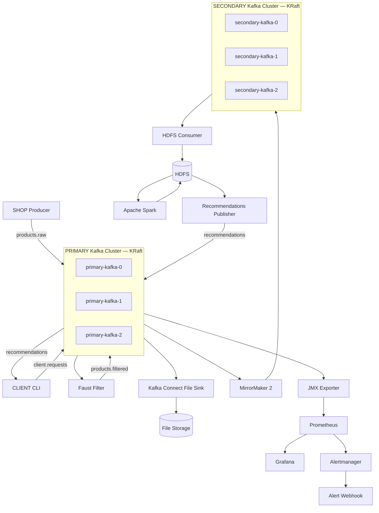

# Финальный проект — Kafka-платформа маркетплейса «Покупай выгодно»

Проект представляет собой распределённую платформу обработки данных маркетплейса на базе Apache Kafka

В системе реализованы:

- два Kafka-кластера в режиме KRaft;
- репликация данных между кластерами через MirrorMaker 2;
- TLS, SASL/PLAIN и ACL;
- эмулятор SHOP API;
- эмулятор CLIENT API;
- потоковая фильтрация товаров через Faust;
- blocklist товаров;
- сохранение отфильтрованных данных через Kafka Connect;
- перенос данных из второго Kafka-кластера в HDFS;
- аналитическая обработка через Apache Spark;
- персонализированные рекомендации;
- публикация рекомендаций обратно в Kafka;
- мониторинг через JMX Exporter, Prometheus и Grafana;
- alerting через Prometheus и Alertmanager;
- проверка отказа Kafka broker

---

## 1. Архитектура



Основной поток данных:

```text
SHOP
 ↓
products.raw
 ↓
Faust
 ↓
products.filtered
 ↓
PRIMARY Kafka
 ↓
MirrorMaker 2
 ↓
SECONDARY Kafka
 ↓
HDFS
 ↓
Spark
 ↓
recommendations
 ↓
PRIMARY Kafka
 ↓
CLIENT
```

Параллельно отфильтрованные товары сохраняются через Kafka Connect:

```text
products.filtered
        ↓
Kafka Connect
        ↓
storage/products.filtered.jsonl
```

---

## 2. Используемые технологии

| Компонент | Назначение |
|---|---|
| Apache Kafka 3.7 | Основная шина сообщений |
| KRaft | Kafka metadata quorum без ZooKeeper |
| MirrorMaker 2 | Репликация между Kafka-кластерами |
| TLS | Шифрование Kafka-соединений |
| SASL/PLAIN | Аутентификация Kafka-клиентов |
| Kafka ACL | Авторизация сервисных пользователей |
| Python | SHOP, CLIENT и analytics services |
| confluent-kafka | Kafka Producer / Consumer |
| Faust Streaming | Потоковая фильтрация товаров |
| Kafka Connect | Выгрузка данных в файл |
| Apache Hadoop / HDFS | Хранение аналитических данных |
| Apache Spark 3.5.7 | Batch-аналитика и рекомендации |
| JMX Exporter 1.7.0 | Экспорт Kafka JMX-метрик |
| Prometheus 3.13.5 | Сбор и хранение метрик |
| Grafana 13.3.1 | Визуализация метрик |
| Alertmanager 0.35.0 | Обработка алертов |
| Docker Compose | Запуск инфраструктуры |

---

## 3. Структура проекта

```text
final_project/
├── data/
│   └── products.json
│
├── infra/
│   ├── kafka/
│   │   ├── certs/
│   │   └── client/
│   │
│   ├── mm2/
│   │
│   ├── connect/
│   │   ├── connect-standalone.properties
│   │   └── products-file-sink.properties
│   │
│   ├── hadoop/
│   │   ├── core-site.xml
│   │   └── hdfs-site.xml
│   │
│   └── monitoring/
│       ├── jmx/
│       │   ├── kafka-kraft.yml
│       │   └── jmx_prometheus_javaagent-1.7.0.jar
│       │
│       ├── prometheus/
│       │   ├── prometheus.yml
│       │   └── alerts.yml
│       │
│       ├── grafana/
│       │   ├── dashboards/
│       │   └── provisioning/
│       │
│       └── alertmanager/
│           └── alertmanager.yml
│
├── services/
│   ├── shop_producer.py
│   ├── client_cli.py
│   ├── blocklist_cli.py
│   ├── alert_webhook.py
│   │
│   ├── filter/
│   │   ├── app.py
│   │   └── models.py
│   │
│   └── analytics/
│       ├── Dockerfile.hdfs
│       ├── requirements.txt
│       ├── hdfs_consumer.py
│       ├── spark_job.py
│       └── publish_recommendations.py
│
├── scripts/
│   ├── generate-kafka-certs.sh
│   ├── generate-client-properties.sh
│   └── generate-mm2-config.sh
│
│
├── .env.example
├── .gitignore
├── docker-compose.yml
├── requirements.txt
└── README.md
```

---

## 4. Kafka-кластеры

Используются два независимых Kafka-кластера.

### PRIMARY

```text
primary-kafka-0
primary-kafka-1
primary-kafka-2
```

External ports:

```text
primary-kafka-0 → localhost:61094
primary-kafka-1 → localhost:61095
primary-kafka-2 → localhost:61096
```

### SECONDARY

```text
secondary-kafka-0
secondary-kafka-1
secondary-kafka-2
```

External ports:

```text
secondary-kafka-0 → localhost:62094
secondary-kafka-1 → localhost:62095
secondary-kafka-2 → localhost:62096
```

Каждый узел одновременно выполняет роли:

```text
broker
controller
```

ZooKeeper не используется.

Для KRaft controller quorum используются все три broker:

```text
0@kafka-0:9093
1@kafka-1:9093
2@kafka-2:9093
```

---

## 5. Kafka topics

Основные topics PRIMARY-кластера:

| Topic | Назначение |
|---|---|
| `products.raw` | Исходные товары от SHOP |
| `products.filtered` | Товары после фильтра Faust |
| `products.blocklist` | События block/unblock |
| `client.requests` | Запросы CLIENT |
| `recommendations` | Рассчитанные рекомендации |

Основные topics имеют:

```text
Partitions:          3
Replication Factor:  3
min.insync.replicas: 2
```

`products.blocklist` дополнительно использует:

```text
cleanup.policy=compact
```

Faust также использует changelog topic:

```text
filter-service-group-blocked-products-changelog
```

MirrorMaker 2 создаёт во SECONDARY удалённые topics с префиксом:

```text
primary.
```

Например:

```text
primary.products.filtered
primary.client.requests
```

---

## 6. Безопасность Kafka

В проекте используется:

```text
SASL_SSL
```

Это означает:

```text
TLS          → шифрование соединения
SASL/PLAIN   → аутентификация
Kafka ACL    → авторизация
```

В обоих Kafka-кластерах используется:

```text
StandardAuthorizer
allow.everyone.if.no.acl.found=false
auto.create.topics.enable=false
```

Основные сервисные пользователи:

| Principal | Назначение |
|---|---|
| `admin` | Администрирование Kafka |
| `broker` | Inter-broker connection |
| `controller` | KRaft controller |
| `shop_producer` | SHOP Producer |
| `client_service` | CLIENT |
| `filter_service` | Faust filter |
| `mirror_maker` | MirrorMaker 2 |
| `connect_service` | Kafka Connect |
| `analytics_service` | HDFS / analytics |

Пример разделения прав:

```text
shop_producer
    WRITE → products.raw

filter_service
    READ  → products.raw
    READ  → products.blocklist
    WRITE → products.filtered

client_service
    WRITE → client.requests
    READ  → recommendations

connect_service
    READ  → products.filtered

analytics_service
    READ  → SECONDARY analytics topics
    WRITE → PRIMARY recommendations
```

Пароли не должны храниться

Они передаются через `.env`

---

## 7. Environment variables

Создайте `.env` на основе `.env.example`.

Требуемые переменные:

```dotenv
BROKER_PASSWORD=
CONTROLLER_PASSWORD=
ADMIN_PASSWORD=

SHOP_PRODUCER_PASSWORD=
CLIENT_SERVICE_PASSWORD=
FILTER_SERVICE_PASSWORD=
MIRROR_MAKER_PASSWORD=
CONNECT_SERVICE_PASSWORD=
ANALYTICS_SERVICE_PASSWORD=

SECONDARY_BROKER_PASSWORD=
SECONDARY_CONTROLLER_PASSWORD=
```

Загрузить переменные в shell:

```bash
set -a
source .env
set +a
```

> `.env` с реальными секретами не должен попадать в Git.

---

## 8. TLS-сертификаты

Kafka использует собственный CA и отдельные сертификаты для broker.

Структура:

```text
infra/kafka/certs/
├── ca/
│   ├── ca.crt
│   └── ca.key
│
├── primary-kafka-0/
├── primary-kafka-1/
├── primary-kafka-2/
│
├── secondary-kafka-0/
├── secondary-kafka-1/
└── secondary-kafka-2/
```

Для генерации broker certificates используется:

```bash
./scripts/generate-kafka-certs.sh
```

После генерации можно проверить сертификат:

```bash
openssl verify \
  -CAfile infra/kafka/certs/ca/ca.crt \
  infra/kafka/certs/primary-kafka-0/kafka.keystore.pem
```

Ожидаемый результат:

```text
OK
```

Client properties генерируются:

```bash
./scripts/generate-client-properties.sh
```

---

## 9. Запуск инфраструктуры

Сначала активируйте environment variables:

```bash
set -a
source .env
set +a
```

Соберите HDFS consumer:

```bash
docker compose build hdfs-consumer
```

Запустите постоянные сервисы:

```bash
docker compose up -d \
  primary-kafka-0 \
  primary-kafka-1 \
  primary-kafka-2 \
  secondary-kafka-0 \
  secondary-kafka-1 \
  secondary-kafka-2 \
  mirror-maker \
  kafka-connect \
  hdfs-namenode \
  hdfs-datanode \
  hdfs-consumer \
  prometheus \
  grafana \
  alertmanager \
  alert-webhook
```

Проверить:

```bash
docker compose ps
```

Spark является batch job и запускается отдельно

---

## 10. Faust Filter

Faust читает:

```text
products.raw
products.blocklist
```

и записывает разрешённые товары в:

```text
products.filtered
```

Запуск:

```bash
source .venv/bin/activate

set -a
source .env
set +a

python services/filter/app.py worker -l info
```

Ожидаемый статус:

```text
Worker ready
```

Пример фильтрации:

```text
product_id=10001 allowed -> products.filtered
product_id=10002 BLOCKED -> dropped
product_id=10003 allowed -> products.filtered
```

Товар `10002` не должен попадать в последующие этапы обработки

---

## 11. SHOP Producer

SHOP эмулируется Python-приложением:

```text
services/shop_producer.py
```

Данные загружаются из:

```text
data/products.json
```

Запуск:

```bash
set -a
source .env
set +a

python services/shop_producer.py
```

Producer отправляет товары в:

```text
products.raw
```

Kafka key:

```text
product_id
```

Producer использует:

```text
acks=all
enable.idempotence=true
```

---

## 12. CLIENT

CLI:

```text
services/client_cli.py
```

Запуск:

```bash
set -a
source .env
set +a

python services/client_cli.py
```

Меню:

```text
1. Найти товар
2. Отправить запрос рекомендаций
3. Посмотреть готовые рекомендации
4. Выход
```

CLIENT отправляет события в:

```text
client.requests
```

Пример search request:

```json
{
  "request_id": "...",
  "user_id": "user_001",
  "request_type": "search",
  "query": "Умные часы",
  "created_at": "..."
}
```

Пример recommendation request:

```json
{
  "request_id": "...",
  "user_id": "user_001",
  "request_type": "recommendations",
  "query": null,
  "created_at": "..."
}
```

---

## 13. MirrorMaker 2

MirrorMaker 2 выполняет одностороннюю репликацию:

```text
PRIMARY
   ↓
SECONDARY
```

Например:

```text
PRIMARY:
products.filtered
client.requests

SECONDARY:
primary.products.filtered
primary.client.requests
```

Проверка:

```bash
docker compose exec secondary-kafka-0 \
  kafka-topics.sh \
  --bootstrap-server secondary-kafka-0:9092 \
  --command-config /opt/bitnami/kafka/config/client/admin.properties \
  --list
```

---

## 14. Kafka Connect

Kafka Connect читает:

```text
products.filtered
```

и записывает данные в:

```text
storage/products.filtered.jsonl
```

Connector:

```text
FileStreamSinkConnector
```

Проверить:

```bash
cat storage/products.filtered.jsonl
```

Заблокированный товар не должен присутствовать:

```bash
if grep -q '"product_id":"10002"' storage/products.filtered.jsonl; then
  echo "ERROR: blocked product 10002 found"
else
  echo "OK: blocked product 10002 is absent"
fi
```

Ожидается:

```text
OK: blocked product 10002 is absent
```

---

## 15. HDFS

HDFS состоит из:

```text
NameNode
DataNode
```

Web UI:

```text
http://localhost:9870
```

Проверка:

```bash
docker compose exec hdfs-namenode \
  hdfs dfsadmin -report
```

Ожидается:

```text
Live datanodes (1)
```

Основные каталоги:

```text
/marketplace/products
/marketplace/client_requests
/marketplace/recommendations
```

Проверка:

```bash
docker compose exec hdfs-namenode \
  hdfs dfs -ls /marketplace
```

---

## 16. Kafka → HDFS

`hdfs_consumer.py` читает данные из SECONDARY:

```text
primary.products.filtered
primary.client.requests
```

и записывает JSON в:

```text
/marketplace/products
/marketplace/client_requests
```

Consumer group:

```text
analytics-hdfs-group
```

Проверить lag:

```bash
docker compose exec secondary-kafka-0 \
  kafka-consumer-groups.sh \
  --bootstrap-server secondary-kafka-0:9092 \
  --command-config /opt/bitnami/kafka/config/client/admin.properties \
  --describe \
  --group analytics-hdfs-group
```

На обработанных partition:

```text
LAG = 0
```

---

## 17. Spark Analytics

Spark работает в batch-режиме

Он читает:

```text
HDFS /marketplace/products
HDFS /marketplace/client_requests
```

и создаёт персонализированные рекомендации

Запуск:

```bash
docker compose up spark-analytics
```

После выполнения container завершается:

```text
Exited (0)
```

Это нормальное состояние для batch job.

Алгоритм:

```text
1. Чтение товаров
2. Дедупликация по product_id
3. Для каждого пользователя определяется последний search
4. Выбирается последний recommendations request
5. Формируются candidate products
6. Вычисляется match_score
7. Товары ранжируются
8. TOP-3 записываются в HDFS
```

При совпадении названия товара с предыдущим поиском:

```text
match_score = 100
```

Дополнительная сортировка:

```text
match_score DESC
stock_available DESC
price_amount ASC
```

Повторные записи одного товара в HDFS удаляются через Spark Window:

```text
partitionBy(product_id)
```

В рекомендации поэтому один `product_id` не дублируется

---

## 18. Публикация recommendations обратно в Kafka

После Spark запускается:

```bash
docker compose run --rm \
  hdfs-consumer \
  python /app/publish_recommendations.py
```

Publisher:

```text
HDFS
 ↓
/marketplace/recommendations
 ↓
PRIMARY Kafka
 ↓
recommendations
```

Kafka key:

```text
user_id
```

Ожидаемый лог:

```text
[SEND] user_id=...
[OK] Recommendation sent topic=recommendations ...
[DONE] Sent recommendations: ...
```

---

## 19. Пример результата CLIENT

Для пользователя:

```text
e2e_user_001
```

с последним поиском:

```text
Умные часы
```

результат:

```text
=== Готовые рекомендации ===

User: e2e_user_001
Последний поиск: Умные часы

1. Умные часы XYZ
   product_id: 10001
   category: Электроника
   price: 4999.99 RUB
   match_score: 100

2. Ноутбук UltraBook 14
   product_id: 10003
   category: Компьютеры
   price: 74999.99 RUB
   match_score: 0
```

---

## 20. Monitoring

### JMX Exporter

На каждом PRIMARY broker запущен JMX Exporter

```text
primary-kafka-0 → localhost:9404
primary-kafka-1 → localhost:9405
primary-kafka-2 → localhost:9406
```

Проверка:

```bash
curl -s http://localhost:9404/metrics | head
```

---

### Prometheus

Prometheus:

```text
http://localhost:9090
```

Targets:

```text
http://localhost:9090/targets
```

Основная проверка:

```promql
up{job="kafka-primary"}
```

В нормальном состоянии:

```text
broker 0 → 1
broker 1 → 1
broker 2 → 1
```

---

### Grafana

Grafana:

```text
http://localhost:3000
```

Dashboard:

```text
Marketplace Kafka Monitoring
```

Основные панели:

```text
Kafka Brokers UP
Kafka Brokers UP historical
Under Replicated Partitions
Under Replicated Partitions historically
Messages In / sec
Bytes In / sec
Bytes Out / sec
```

Основные Kafka metrics:

```text
kafka_server_brokertopicmetrics_messagesin_total
kafka_server_brokertopicmetrics_bytesin_total
kafka_server_brokertopicmetrics_bytesout_total
kafka_server_replicamanager_underreplicatedpartitions
```

Для counters используется PromQL `rate()`.

Пример:

```promql
sum by (broker) (
  rate(
    kafka_server_brokertopicmetrics_messagesin_total{
      job="kafka-primary",
      topic=~".+"
    }[1m]
  )
)
```

---

## 21. Alertmanager

Alertmanager:

```text
http://localhost:9093
```

Prometheus rule:

```yaml
alert: KafkaBrokerDown
expr: up{job="kafka-primary"} == 0
for: 30s
```

Alert имеет labels:

```text
severity=critical
service=kafka
```

Alertmanager отправляет уведомление в локальный webhook:

```text
alert-webhook:5001
```

---

## 22. Проверка отказа Kafka broker

Для проверки:

```bash
docker compose stop primary-kafka-2
```

Через некоторое время:

```promql
up{job="kafka-primary",broker="2"}
```

становится:

```text
0
```

Prometheus rule переходит:

```text
inactive
   ↓
pending
   ↓
firing
```

Webhook получает:

```json
{
  "status": "firing",
  "commonLabels": {
    "alertname": "KafkaBrokerDown",
    "broker": "2",
    "severity": "critical"
  }
}
```

После восстановления:

```bash
docker compose start primary-kafka-2
```

метрика возвращается:

```text
up = 1
```

а webhook получает:

```json
{
  "status": "resolved"
}
```

Таким образом проверена реакция мониторинга и alerting на реальный отказ Kafka broker

---

## 23. End-to-End тест

Полная проверенная цепочка:

```text
SHOP
 ↓
products.raw
 ↓
Faust
 ↓
products.filtered
 ↓
Kafka Connect → file
 ↓
MirrorMaker 2
 ↓
SECONDARY Kafka
 ↓
HDFS Consumer
 ↓
HDFS
 ↓
Spark
 ↓
HDFS Recommendations
 ↓
Publisher
 ↓
PRIMARY Kafka / recommendations
 ↓
CLIENT
```

Для теста использовался пользователь:

```text
e2e_user_001
```

Search:

```text
Умные часы
```

CLIENT отправил:

```text
search
recommendations
```

MirrorMaker перенёс оба события во SECONDARY

HDFS Consumer сохранил события в HDFS

Spark сформировал рекомендации:

```text
1 → product_id=10001, match_score=100
2 → product_id=10003, match_score=0
```

Publisher записал рекомендации обратно в PRIMARY Kafka

CLIENT успешно получил результат

Одновременно Grafana зафиксировала изменение:

```text
Messages In / sec
Bytes In / sec
Bytes Out / sec
```

End-to-End тест завершён успешно

---

## 24. Полезные URL

| Сервис | URL |
|---|---|
| Grafana | `http://localhost:3000` |
| Prometheus | `http://localhost:9090` |
| Prometheus Targets | `http://localhost:9090/targets` |
| Alertmanager | `http://localhost:9093` |
| HDFS NameNode | `http://localhost:9870` |
| Alert Webhook | `http://localhost:5001` |
| JMX Broker 0 | `http://localhost:9404/metrics` |
| JMX Broker 1 | `http://localhost:9405/metrics` |
| JMX Broker 2 | `http://localhost:9406/metrics` |


Пример подключения изображения в README:

```markdown

```

---

## 26. Остановка

Остановить containers:

```bash
docker compose down
```

Named volumes при этом сохраняются

Полностью удалить данные:

```bash
docker compose down -v
```

> `down -v` удаляет Kafka, HDFS, Prometheus, Grafana и другие данные из named volumes.

---

## 27. Troubleshooting

### Kafka CLI пытается повторно запустить JMX Exporter

Kafka broker имеет `KAFKA_OPTS` с `javaagent`

Поэтому при запуске Java Kafka CLI внутри broker-container можно получить:

```text
java.net.BindException: Address already in use
```

Используйте:

```bash
docker compose exec primary-kafka-0 \
  env -u KAFKA_OPTS \
  kafka-topics.sh ...
```

---

### `Coordinator load in progress`

Producer может временно вывести:

```text
Broker: Coordinator load in progress: retrying
```

Если после этого появляется:

```text
[OK] ... sent
```

сообщение было успешно доставлено после retry

---

### Spark container завершился

```text
Exited (0)
```

для `spark-analytics` означает успешное завершение batch job

---

### Kafka console consumer завершился с TimeoutException

При использовании:

```text
--timeout-ms
```

consumer завершает работу после отсутствия новых сообщений

Если перед этим есть:

```text
Processed a total of N messages
```

это ожидаемое поведение.

---

## 28. Безопасность репозитория

В публичный Git-репозиторий нельзя добавлять:

```text
.env
CA private key
broker private keys
client properties с паролями
локальные Kafka/HDFS данные
Python virtualenv
```

Перед публикацией необходимо проверить Git history и staged files на отсутствие секретов

---

## 29. Результат

В проекте реализован полный pipeline:

```text
Secure Kafka ingestion
        ↓
Stream filtering
        ↓
Cross-cluster replication
        ↓
Persistent storage
        ↓
Spark analytics
        ↓
Personalized recommendations
        ↓
Kafka response
        ↓
Monitoring and alerting
```

Проверены:

```text
Kafka KRaft cluster              ✅
TLS                              ✅
SASL/PLAIN                       ✅
Kafka ACL                        ✅
MirrorMaker 2                    ✅
Faust filtering                  ✅
Blocklist                        ✅
Kafka Connect                    ✅
HDFS                             ✅
Spark                            ✅
Recommendations                  ✅
CLIENT response                  ✅
JMX Exporter                     ✅
Prometheus                       ✅
Grafana                          ✅
Alertmanager                     ✅
Broker failure / recovery        ✅
End-to-End pipeline              ✅
```